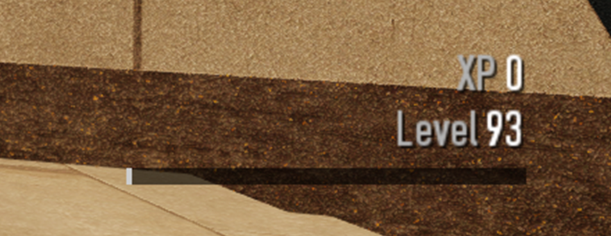
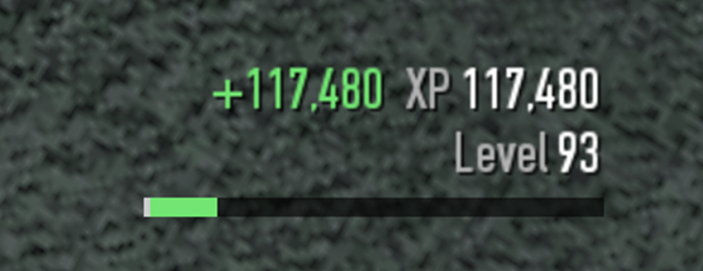
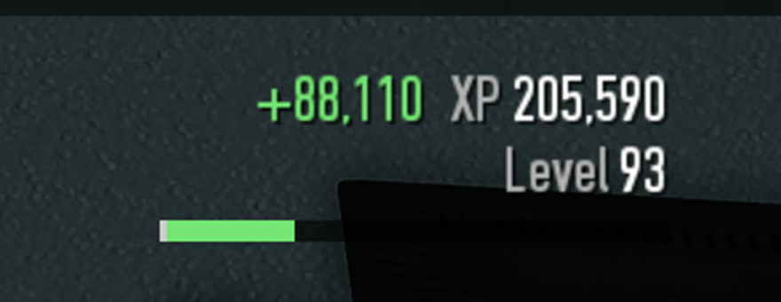
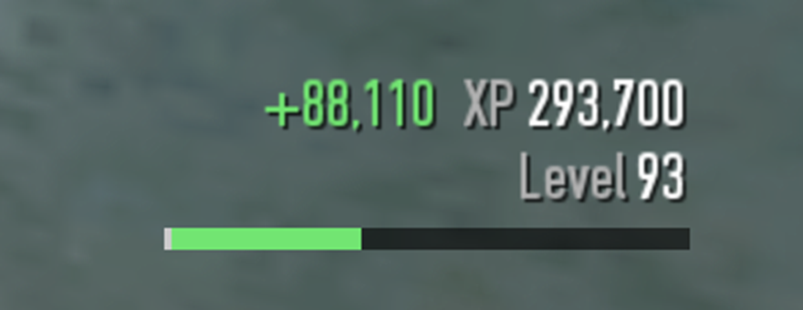

# XP Total HUD

PAYDAY 2 BLT mod. Shows XP numbers in three places.

In heists, a small label with the XP the current day pays if it ends now, the level you will be once it pays out, and a bar for that level:

| | |
|---|---|
|  |  |
| Start of the heist: nothing earned yet | First objective: +117,480 |
|  |  |
| Second objective: +88,110 | Third objective: +88,110 |

Big Bank at level 93, cropped and zoomed 2x from 2560x1440 with VanillaHUD Plus. The bar fills toward level 94 as objectives pay out.

The level reads `93` until the day's XP is enough for a level-up, then `93 > 94` in green. In the bar, white is the progress you already have in that level and green is what the day adds. After a level-up the bar is all green, since all progress in the new level comes from the day.

In the main menu profile box, under CASH / OFFSHORE ACCOUNT / COINS, in the same style:

```
TOTAL XP: 12,868,330
TO INFAMY: 10,468,083
```

In lobbies, which have no profile box, the same two lines as a small label under the lobby code.

The heist total is the same number XP Notifier prints as "Total XP". The green `+gain` appears for 5 seconds after an objective gives XP. Gains that land within that window add up.

## Install

Copy the `XP Total HUD` folder into `PAYDAY 2/mods/`. Requires SuperBLT. The `screenshots` folder is only for this README and can be left out.

## Level lines

- `Total XP`: XP earned through levels since the last infamy reset: the points of every level reached plus progress into the next one.
- `To infamy`: XP left to level 100. Shows `ready` at level 100. At the maximum infamy rank, where you can't go infamous, it reads `To level 100` (below 100) or is left out (at 100).
- `Infamy pool`: only at level 100 while infamous, since that is when XP goes into the pool. Shows the pool's progress against its 30,000,000 cap (`tweak_data.experience_manager.prestige_xp_max`).

From level 0, levels 1-100 total 23,336,413 XP. `tweak_data.experience_manager.levels` also holds unused entries for levels 146-193. Only levels up to `ExperienceManager:level_cap()` are counted.

## Options

Mod Options > XP Total HUD. While this menu is open, a sample heist label (`XP 1,234,567` / `+12,345`) and the lobby label are drawn where they sit, and they move as the sliders change. This works from the main menu and from the pause menu in a heist. In a heist the real heist label is hidden while the preview is up.

| Option | Default | Notes |
|---|---|---|
| Heist: show XP total | on | |
| Heist: horizontal / vertical position | 100 / 65 | 65 is above the bottom-right player panel and above the "CARRYING:" box and throw hint the game draws over it while a bag is carried, also with the level lines added. |
| Heist: show last gain | on | |
| Heist: show level at day end | on | `Level 93`, or `Level 93 > 94` in green when the day levels you up. At level 100 while infamous, `Infamy pool 62%` (the pool's fill after the day). |
| Heist: show XP bar | on | Bar for the end level, under the lines. At level 100 while infamous it tracks the infamy pool. At least 8 x the text size wide so it doesn't jump as the numbers change. |
| Heist: add level XP | off | Appends the level lines under the heist total. |
| Main menu: add to profile box | on | Takes effect the next time the main menu screen is shown. |
| Lobby: show level XP | on | |
| Lobby: horizontal / vertical position | 0 / 27 | 27 is under the lobby code, above the chat. |
| Text size | 18 | Heist and lobby labels. The profile box uses the game's font. |
| Opacity (%) | 100 | Heist and lobby labels. |
| Round to thousands | off | `1,235K` instead of `1,234,567`. |

Settings are saved to `mods/saves/xp_total_hud.json` on every change.

Positions are percentages of the HUD safe area: 0 puts the label against the left/top edge, 100 against the right/bottom edge, 50 centers it. Lines align to the edge the label is near. The gain goes on the inner side of the first line so that line does not shift when it appears.

## How it works

- `lib/managers/hudmanagerpd2`: post-hook on `HUDManager:_setup_player_info_hud_pd2` adds a panel named `xp_total_hud` to the `PLAYER_INFO_HUD_PD2` panel (the same parent as the vanilla hint, heist timer and objectives). It hides with the rest of the HUD.
- The heist total is `ExperienceManager:get_xp_dissected(true, alive players, not in custody)`, the call `MissionEndState` makes on a successful day. It is recomputed every second because it changes when players die, go into custody or leave, not only when objectives pay.
- `lib/managers/experiencemanager`: pre/post hooks on `ExperienceManager:mission_xp_award` compare the total before and after each award to get the gain after all multipliers.
- The level at day end replays `ExperienceManager:add_points` on the heist total: the rest of the current level (`next_level_data_points - next_level_data_current_points`), then each next level's points from the cached level table. At the level cap the remainder goes to the infamy pool when the infamy rank is above 0 and is lost otherwise, as in the game. `MissionEndState` gives that same total through `give_experience` on a successful day.
- Level XP comes from `current_level`, `next_level_data_current_points`, `current_rank` and the prestige XP getters. The level point table is read once through `tweak_data:get_value` and cached.
- `lib/managers/menu/playerprofileguiobject`: post-hook on `PlayerProfileGuiObject:init` appends the lines to the text column (found 15 units right of the prestige ring, where vanilla puts CASH / OFFSHORE ACCOUNT / COINS), colors the labels with `make_color_text` like vanilla, then grows the box upward from its fixed bottom edge. BLT's notification box is created after the profile box and anchored to its top, so it moves up with it. If nothing sits in that column (a modded box), the box is left alone. The box is rebuilt every time the main menu screen is shown, so the lines are current.
- `lib/states/menumainstate`: `at_enter` / `at_exit` bound the lobby label to the menu state. Within it, the label shows only while the selected menu node is `lobby` (checked every frame), so it doesn't sit over the inventory or other screens opened from the lobby.
- The lobby label and the options preview share one safe-rect workspace at `tweak_data.gui.ATTRACT_SCREEN_LAYER`: above menu components, below dialogs and the cursor.
- `lib/managers/menumanager`: options menu. The preview is shown from the node's `focus_changed_callback`. Closing the whole menu with Escape skips that callback, so the preview also checks every frame that its node is still the selected one.

## Compatibility

- VanillaHUD Plus: no VanillaHUD Plus function is replaced. VanillaHUD Plus re-lays out the HUD workspace with its own scale (`GuiDataManager:layout_scaled_fullscreen_workspace`); the overlay workspace applies the same layout when that function exists, so preview and in-heist positions match. If a label overlaps a HUDList list, move it with the sliders.
- VanillaHUD Plus driving HUD: its vehicle box sits on top of the player panel (bottom ≈ 586 on the 720-unit HUD) and is about 85 units tall with the name, passengers and speed rows (top ≈ 501). The default Y 65 clears it. Each extra row makes the box 24 units taller, and the vehicle picture adds 150. With more rows on, lower the heist vertical position.
- BLT notifications: stays above the profile box, see above.
- XP Notifier: independent, both can run.

## Limitations

- The heist label is hidden in Crime Spree, which pays XP by spree level rather than with the heist formula.
- The heist total assumes the day ends in success with the players alive right now. Multi-day jobs show the current day only, like XP Notifier.
- If a calculation throws, the last value stays on screen and the error is logged once to the BLT log.
