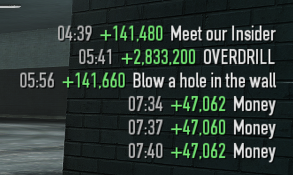
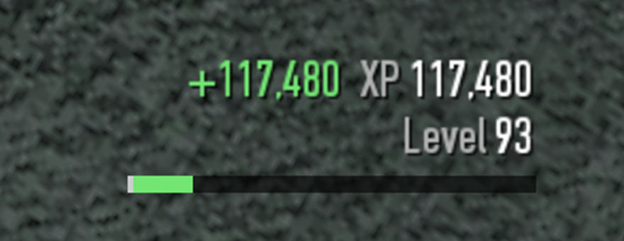
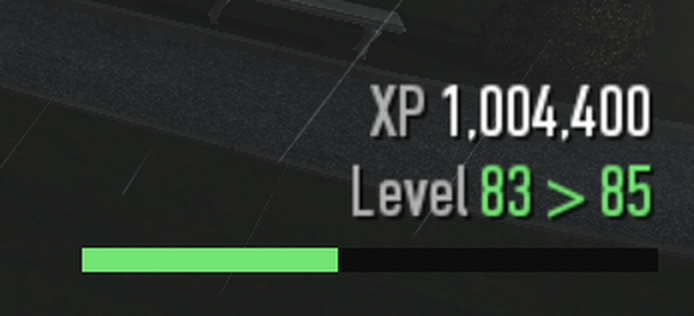

# XP Total HUD

A PAYDAY 2 SuperBLT mod that shows what the current heist day is worth in XP while you play it, which level that takes you to, and what paid each award.

<table>
<tr>
<td></td>
<td><br><br> 85, green bar"></td>
</tr>
<tr>
<td>Heist log on First World Bank. Each XP award with the objective or bag that paid it.</td>
<td>Day total with the last gain, the level once the day pays out, and the bar for that level.</td>
</tr>
</table>

<sub>In-game crops at 2560x1440 with VanillaHUD Plus. The two on the right are zoomed 2x.</sub>

## What it shows

**In heists**

- **XP total:** what the day pays if it ends now, the same number XP Notifier prints as "Total XP". The latest gain shows next to it in green for 5 seconds.
- **Level at payout:** `Level 93`, then `Level 93 > 94` in green once the day's XP is enough to level up (`83 > 85` across several levels). At level 100 while infamous it shows the infamy pool instead.
- **XP bar:** white is the progress you already had in that level, green is what the day adds.
- **Heist log:** one line per XP award with the heist time, the amount after multipliers and what paid it: the objective, the bag type (`Money`, `Gold`), or the mission script's own name for it in grey. See [How log lines are named](#how-log-lines-are-named).

**In the main menu**, two lines in the profile box under CASH / OFFSHORE ACCOUNT / COINS:

```
TOTAL XP: 12,868,330
TO INFAMY: 10,468,083
```

**In lobbies**, which have no profile box, the same two lines as a small label under the lobby code.

Everything can be moved, resized or turned off in Mod Options, with a live preview.

## Install

1. Install [SuperBLT](https://superblt.znix.xyz/).
2. Copy the `XP Total HUD` folder into `PAYDAY 2/mods/`.

The `screenshots` and `tools` folders are only used by this page and by the name table script, and can be left out.

## Options

**Mod Options > XP Total HUD.** While the menu is open, sample labels are drawn where the real ones sit and follow the sliders, from the main menu or the pause menu. Settings are saved to `mods/saves/xp_total_hud.json`.

Positions are percentages of the HUD safe area: 0 is the left or top edge, 100 the right or bottom edge, 50 the center. Text aligns to the nearest edge.

| Heist label | Default | |
|---|---|---|
| Show XP total | on | |
| Horizontal / vertical position | 100 / 65 | Above the bottom-right player panel and the carried-bag box. |
| Show last gain | on | |
| Show level at day end | on | `Infamy pool 62%` at level 100 while infamous. |
| Show XP bar | on | At least 8x the text size wide, so it doesn't jump as the numbers change. |
| Add level XP | off | Appends the two menu lines under the heist total. |

| Heist log | Default | |
|---|---|---|
| Show | on | |
| XP gains | on | Not in Crime Spree. |
| New objectives | off | A line when each objective appears. XP for completing it then goes on that line. |
| Completed objectives | off | `Done ...` lines for objectives and sub-objectives. |
| Name length | 26 | Anything in brackets is dropped, then names are cut at a word boundary. |
| Heist time | on | |
| Horizontal / vertical position | 100 / 40 | At 50 or less the log fills from the top, above 50 from the bottom. |
| Lines | 6 | |
| Fade after (seconds) | 0 | 0 keeps lines until newer ones push them out. |

| Menus and general | Default | |
|---|---|---|
| Main menu: add to profile box | on | Applies the next time the main menu is shown. |
| Lobby: show level XP | on | |
| Lobby: horizontal / vertical position | 0 / 27 | Under the lobby code, above the chat. |
| Text size | 18 | Heist and lobby labels. The profile box uses the game's font. |
| Opacity (%) | 100 | Heist and lobby labels. |
| Round to thousands | off | `1,235K` instead of `1,234,567`. |

## Level lines

| Line | Meaning |
|---|---|
| Total XP | XP earned through levels since the last infamy reset: every level reached plus progress into the next. Levels 1-100 total 23,336,413 XP. |
| To infamy | XP left to level 100, or `ready` at 100. At the maximum infamy rank it reads `To level 100`, or is left out at 100. |
| Infamy pool | Only at level 100 while infamous, when XP goes to the pool. Progress against its 30,000,000 cap. |

## How log lines are named

Each award takes the first label that applies:

1. **The bag just secured**, named after its loot type, when the heist pays that amount per bag. First World Bank pays 1000 base XP per bag, the same as a security code, so the bag decides.
2. **The objective that pays that amount** on this heist, from the name table, when only one does.
3. **The best word match** with the mission element's name, when several objectives pay the same amount (`XP_found_LiDeng_or_Xunkang_stealth` becomes `Found Li Deng or Xun Kang`).
4. **A sub-objective, then an objective,** completed within 2 seconds of the award.
5. **A bag secured just before**, when the table doesn't know the amount.
6. **The mission element's name**, cleaned up and shown in grey (`xp_pager_answered_002` becomes `Pager answered`).
7. **Both names**, joined with ` / `, when exactly two objectives share the amount.

XP paid for completing an objective goes on that objective's line when "new objectives" is on. Awards with the same label less than a second apart share a line.

### Name table

`lua/ehi_xp_names.lua` maps each heist's base XP amounts to objective names and lists the amounts paid per bag. It covers 109 heists and is generated from [Extra Heist Info](https://modworkshop.net/mod/31915) (EHI) by Dom, which doesn't need to be installed. To rebuild it after an EHI update, download EHI and run:

```
python -I tools/extract_ehi_xp.py "<EHI folder holding lua/ and loc/>"
```

The script reads EHI's level files and `loc/english.json` as text and runs none of its code. Awards the table doesn't know are written to the BLT log once per heist and amount, as `[XP Total HUD] no XP name: ...`.

## Compatibility

- **VanillaHUD Plus:** works, and the defaults are tuned for it. Its HUD scale is applied to the menu preview so positions match in heists. If a label overlaps a HUDList list or the vehicle box, move it with the sliders. The default position clears the vehicle box with its name, passengers and speed rows; with more rows on, lower the label.
- **XP Notifier:** independent, both can run.
- **BLT update notifications:** the box in the main menu moves up with the taller profile box.

No game function is replaced: every change is a pre- or post-hook.

These HUD mods were checked in code, not yet in game. None of them replaces a function this mod hooks without calling the original, or changes the HUD workspace it draws on:

| Mod | Notes |
|---|---|
| WolfHUD | Compatible. The original (v3.4.0, 2022) has open crash reports on the current game; VanillaHUD Plus is its maintained continuation. While driving, the vehicle box sits above the player panel and can cover the label. A larger right list, or the assault banner moved to the right, can reach the log. |
| VoidUI | Compatible. Its carried-bag box sits a little under the label at 65; with a higher VoidUI scale or the level lines added, raise the label. Its black-screen fade-in fades the label with the rest of the HUD. |
| PocoHud3 | Compatible with the maintained build ([modworkshop 40870](https://modworkshop.net/mod/40870)). Its default panels are on the left and bottom, clear of both labels. The original by zenyr stopped in 2017. |
| HoxHUD | Doesn't run on the current game: its loader DLLs are 32-bit and PAYDAY 2 is 64-bit. |

## Limitations

- The heist label is hidden in Crime Spree, which pays XP by spree level rather than with the heist formula.
- The total assumes the day ends in success with the players alive right now. Multi-day jobs show the current day only.
- Custom heists, and heists newer than the name table, fall back to labels 4-6.
- The table maps amounts, not mission elements: an award whose amount matches a single objective takes its name even if something else paid it.
- If a calculation fails, the last value stays on screen and the error is logged once.

<details>
<summary><b>How it works</b></summary>

<br>

- **Heist label:** `lib/managers/hudmanagerpd2` post-hooks `HUDManager:_setup_player_info_hud_pd2` and adds an `xp_total_hud` panel to `PLAYER_INFO_HUD_PD2`, the parent of the vanilla hint, timer and objectives, so it hides with the HUD.
- **Total:** `ExperienceManager:get_xp_dissected(true, alive players, not in custody)`, the call `MissionEndState` makes on a successful day. It is recomputed every second, since deaths, custody and players leaving change it too.
- **Gains:** pre/post hooks on `ExperienceManager:mission_xp_award` compare the total before and after each award.
- **Award source:** pre/post hooks on `ElementExperience:on_executed` (clients run it through `client_on_executed`) record the element's editor name and base `_values.amount`.
- **Bags:** a pre-hook on `LootManager:sync_secure_loot`, which the host runs before the loot triggers fire the bag's Experience element, and which clients receive before that element's sync. Each bag labels at most one award.
- **Objectives:** post-hooks on `ObjectivesManager` `activate_objective`, `complete_sub_objective` and the countdown variants; pre/post hooks on `complete_objective`, so objectives with an amount ("bag 4 of 8") are logged once, when they leave the active list. Calls with `load_data` (drop-in restore) are skipped.
- **Level at payout:** replays `ExperienceManager:add_points` on the day total: the rest of the current level, then each next level from the cached level table. At the cap the rest goes to the infamy pool when the infamy rank is above 0 and is lost otherwise, as in the game. Only levels up to `level_cap()` count; the tweak data also holds unused entries for 146-193.
- **Profile box:** a post-hook on `PlayerProfileGuiObject:init` appends the lines to the vanilla text column (15 units right of the prestige ring), colors the labels with `make_color_text`, and grows the box upward from its fixed bottom. A modded box without that column is left alone.
- **Lobby label:** `MenuMainState` `at_enter` / `at_exit` bound it to the menu state. It shows only while the selected node is `lobby`, checked every frame. It shares a safe-rect workspace with the options preview at `ATTRACT_SCREEN_LAYER`, above menu components and below dialogs.
- **Options preview:** shown from the node's `focus_changed_callback`. Closing the menu with Escape skips that callback, so the preview also checks every frame that its node is still selected. VanillaHUD Plus's `GuiDataManager:layout_scaled_fullscreen_workspace` is applied to the preview workspace when it exists.

</details>

## Credits

Objective names and per-bag amounts in `lua/ehi_xp_names.lua` come from [Extra Heist Info](https://modworkshop.net/mod/31915) by Dom.
